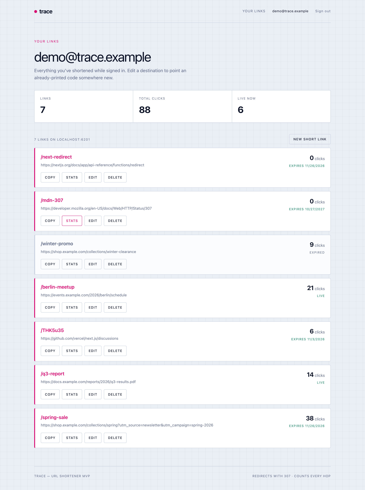
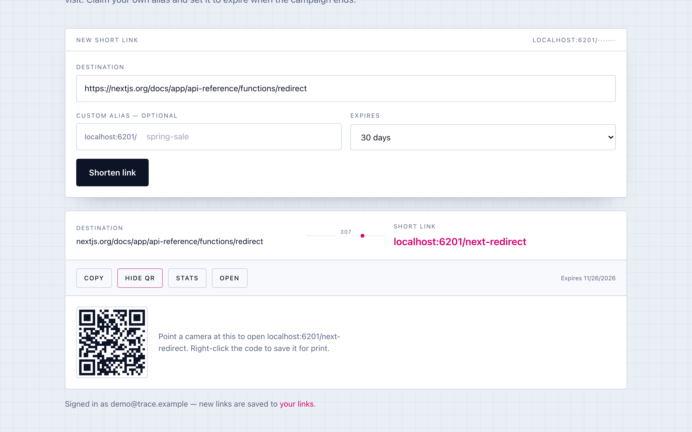
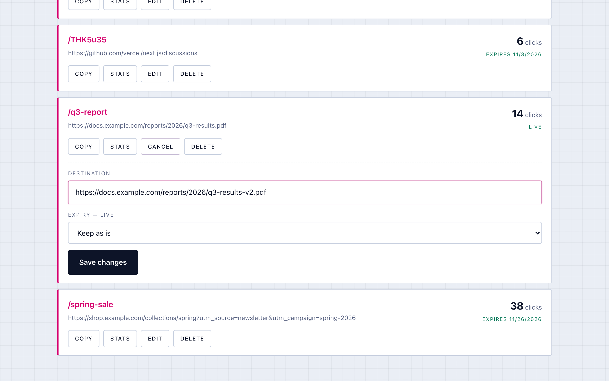
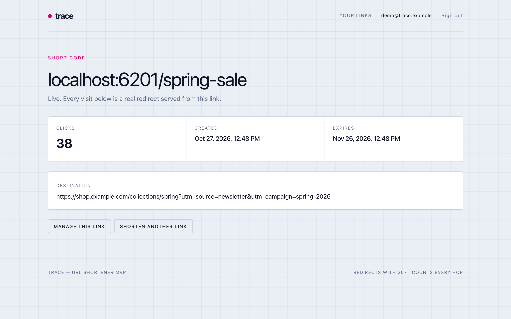
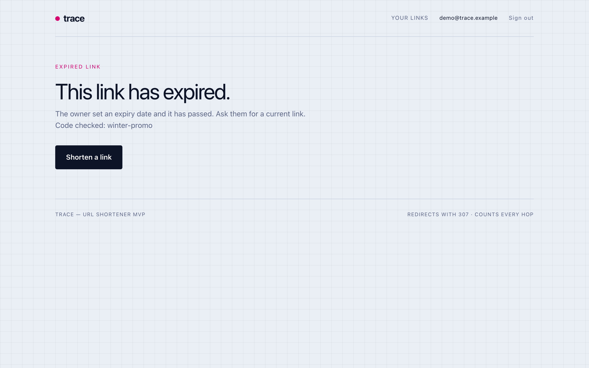
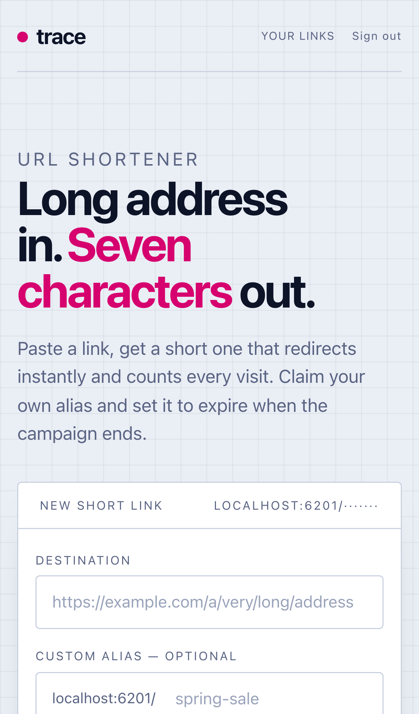
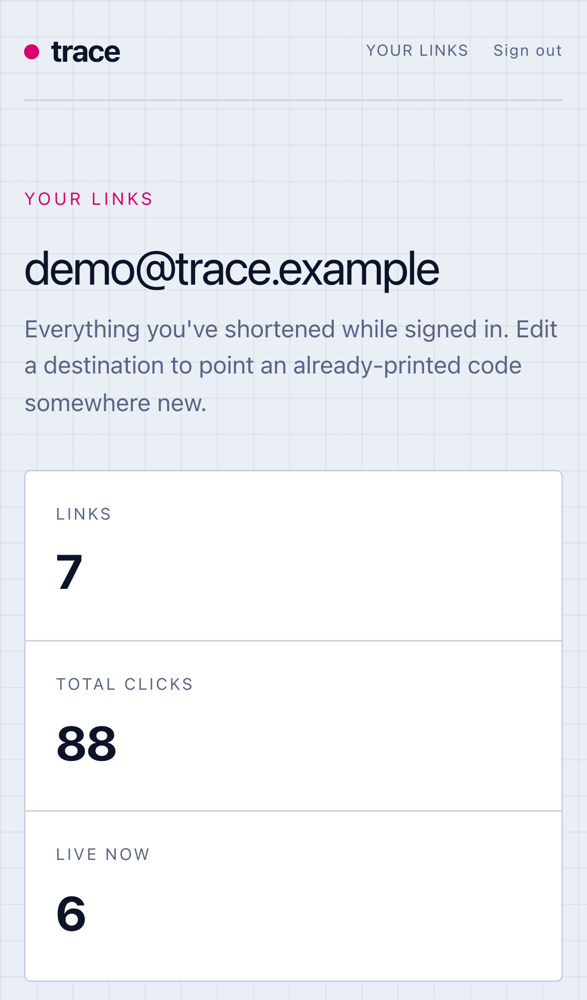
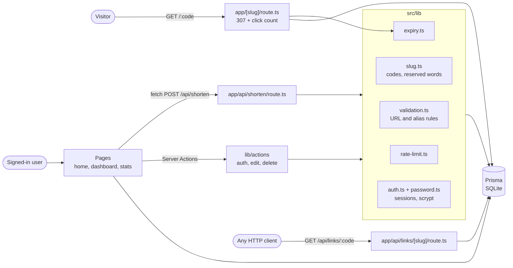

# Trace

**Short links you can still change after they are printed.**

Trace is a URL shortener built with Next.js 16, Prisma and SQLite. Paste a long address
and get a seven-character code, or claim your own alias. Every visit is a real `307`
redirect that gets counted, links can expire on a date you choose, and signed-in users
can point an existing code at a new destination without reprinting it.



**Demo video (51 s):** [docs/demo/trace-demo.mp4](docs/demo/trace-demo.mp4). Recorded
against a local production build. Trace is not deployed anywhere, so there is no live link.
[How the demo was made](docs/demo/README.md).

## Why it exists

A short link usually ends up somewhere you cannot edit: a printed flyer, a slide, a QR code
on a poster, a newsletter that has already gone out. When the page behind it moves, the
link breaks, or worse, it quietly keeps pointing at last season's sale.

Trace treats the short code as the stable thing and the destination as the part that
changes. The owner can repoint it, give it an end date, or delete it, and the redirect
picks up the change on the next visit because nothing along the way caches it. Visitors
who arrive after a link has expired get a page that says so, instead of landing on a
stale page or a generic 404.

It is aimed at the people who hand out links for a living: someone running a campaign,
an event, or a team that prints QR codes and wants to know whether anyone scanned them.

## What it does

| | |
| --- | --- |
|  | **Shorten, with or without an account.** Paste a URL (the `https://` is optional), pick an alias if you want one, and choose an expiry of 1, 7, 30 or 365 days. The result card shows the short link, a copy button and a QR code drawn in the browser. |
|  | **Repoint a code in place.** On the dashboard, Edit opens the destination and expiry for that link. Saving changes where the code goes from the next visit on; the code itself never changes. |
|  | **See whether it was used.** Each redirect increments a counter and records the last visit. The stats page and `GET /api/links/<code>` show clicks, creation date, expiry and destination. The home page also has a lookup box that accepts a code or a full short URL. |
|  | **Let links end on purpose.** Once a link passes its expiry it stops redirecting, keeps its click history, and visitors see an explanation instead of a dead end. |

Shorter details that matter in practice:

- **Codes that survive being read aloud.** Generated codes use 7 characters from an
  alphabet with no `0/O` or `1/l/I`. A collision is retried up to five times.
- **Aliases that cannot shadow the app.** Aliases are 3 to 32 letters, digits, `-` or `_`.
  Words the app uses for its own routes (`dashboard`, `api`, `stats`, `login` and so on)
  are reserved, and a unit test fails if a new top-level route is added without
  reserving its name.
- **Guardrails on destinations.** Only `http` and `https`, no private or loopback
  addresses, and no links back to the shortener itself, so codes cannot be chained into
  loops. The same rules run when a link is edited, not just when it is created.
- **Rate limits.** 20 links a minute per client IP for shortening, 10 attempts a minute
  for sign-up and sign-in.
- **Works on a phone.** The layout was checked at 375 px wide with no horizontal scrolling.

<p>
  
  
</p>

## Walkthrough

The demo video follows this path, and you can repeat it locally in a couple of minutes:

1. On the home page, shorten `https://nextjs.org/docs/app/getting-started/route-handlers`
   with the alias `route-docs` and a 30-day expiry.
2. Open `localhost:6201/route-docs`. The browser lands on the Next.js docs.
3. Open the stats page for `route-docs`. It shows 1 click.
4. Create an account and open **Your links**. Links made while signed in are listed with
   their click counts and live or expired status.
5. Edit a link's destination and save. The same code now redirects to the new address.
6. Try to shorten `http://192.168.0.1/admin`, or reuse an alias that is taken. Both are
   refused with a message under the form.

## How it works



Everything runs inside one Next.js app on the Node.js runtime. There is no separate
backend, queue or cache.

- **The redirect** is a route handler at `src/app/[slug]/route.ts`. It looks up the code,
  sends unknown or expired codes to an explanation page, increments the click count, and
  returns a `307` with `Cache-Control: no-store`.
- **Creating links** goes through `POST /api/shorten`, which the home page form calls with
  `fetch`. It is also usable on its own with `curl`.
- **Account work** (sign-up, sign-in, sign-out, editing and deleting links) uses Server
  Actions in `src/lib/actions`.
- **Business rules** live in `src/lib` as plain functions. Route handlers and actions do the
  transport work: parse input, check ownership, call Prisma, shape the response.

### Decisions and trade-offs

**`307`, never cached.** A `301` would be cached by browsers indefinitely, which defeats
the point of an editable link. `307` plus `no-store` means each visit reaches the server,
so edits and expiries apply immediately and every visit is counted. The cost is a
database read and write per redirect.

**Counting never blocks the redirect.** The click update is best effort: if it fails, the
visitor is still redirected. Click counts are analytics, not billing, so availability
wins.

**Hand-rolled sessions instead of an auth provider.** The app needs exactly one thing from
auth: knowing who owns a link. Passwords are hashed with Node's `scrypt` and a random
16-byte salt and compared in constant time. A session is a 32-byte random token in an
`httpOnly`, `sameSite=lax` cookie, and only its SHA-256 hash is stored, so a copy of the
database does not contain usable sessions. Sign-in runs the hash even for unknown emails,
so response time does not reveal which accounts exist. The trade-off is no password
reset, email verification or OAuth yet.

**Ownership is checked on every write.** Edit and delete re-load the link on the server
and compare its owner with the signed-in user. A link that is someone else's and a link
that does not exist get the same answer, so the API does not confirm which codes exist.
Links made while signed out have no owner and cannot be edited later.

**SQLite for now.** It keeps setup to `npm install` and one migration. It is also the
main thing standing between this code and a deployment (see
[Status and limitations](#status-and-limitations)).

## Tech stack

| Area | Used |
| --- | --- |
| Framework | Next.js 16.3 (App Router, Route Handlers, Server Actions), React 19.2 |
| Language | TypeScript, strict mode |
| Data | Prisma 6 with SQLite |
| Validation | Zod 4 |
| Codes and QR | nanoid (custom alphabet), qrcode (rendered client-side) |
| Auth | Node `crypto`: scrypt for passwords, random tokens for sessions |
| Styling | Hand-written CSS in `src/app/globals.css`. Tailwind 4 is installed, but only its base reset is used |
| Testing | Vitest (unit and integration projects) |
| Tooling | ESLint (`eslint-config-next`), GitHub Actions workflow |

## Getting started

You need Node.js 22 (the version CI uses) and npm. The app has also been run locally on
Node 20.18.

```bash
npm install
cp .env.example .env
npm run db:migrate
npm run dev
```

`db:migrate` creates `prisma/dev.db` and applies the migrations. Then open
http://localhost:6201.

| Variable | Purpose |
| --- | --- |
| `DATABASE_URL` | Prisma connection string. `file:./dev.db` for local SQLite. |
| `NEXT_PUBLIC_APP_URL` | Public origin used to build short links. If unset, Trace uses `VERCEL_PROJECT_PRODUCTION_URL`, then the request's host. |

| Command | What it does |
| --- | --- |
| `npm run dev` | Dev server on port 6201 |
| `npm run build` then `npm start` | Production build and server |
| `npm run lint` | ESLint |
| `npm run typecheck` | `tsc --noEmit` |
| `npm test` | Unit and integration tests, once (`npm run test:watch` to watch) |
| `npm run db:migrate` | `prisma migrate dev` |

## Project structure

```
src/
  app/
    page.tsx                  Home: shorten form and stats lookup
    [slug]/route.ts           Redirect and click counting
    api/shorten/route.ts      POST: create a short link
    api/links/[slug]/route.ts GET: one link's stats as JSON
    stats/[slug]/page.tsx     Stats page
    dashboard/page.tsx        The signed-in user's links
    link-not-found/page.tsx   Unknown and expired codes land here
    login/, signup/           Account forms
  components/                 Client components: shorten form, dashboard row, auth form
  lib/
    validation.ts             Destination and alias rules
    slug.ts                   Code generator, reserved words, alias pattern
    expiry.ts                 Expiry checks and date maths
    rate-limit.ts             In-memory fixed-window limiter, client IP parsing
    password.ts               scrypt hashing and verification
    auth.ts                   Sessions and getCurrentUser()
    actions/                  Server Actions for auth and link edit/delete
  test/                       Integration test harness (fakes for next/headers etc.)
prisma/
  schema.prisma               User, Session and Link models
  migrations/
docs/
  screenshots/, demo/         README images and the demo video
```

## API

Create a link. `slug` and `expiresInDays` are optional. If the request carries a session
cookie, the link belongs to that user.

```bash
curl -X POST localhost:6201/api/shorten \
  -H 'content-type: application/json' \
  -d '{"url":"https://example.com/long","slug":"spring-sale","expiresInDays":30}'
```

```json
{
  "slug": "spring-sale",
  "shortUrl": "http://localhost:6201/spring-sale",
  "url": "https://example.com/long",
  "clicks": 0,
  "createdAt": "2026-10-27T08:26:33.262Z",
  "expiresAt": "2026-11-26T08:26:33.260Z"
}
```

| Status | When |
| --- | --- |
| `201` | Created |
| `400` | Invalid JSON, URL, alias or expiry, with `{ "error": "..." }` |
| `409` | Alias already taken |
| `429` | Rate limited, with a `Retry-After` header |

Read one link's stats with `GET /api/links/<code>`. It returns the same fields plus
`lastVisit`, or `404`.

### Data model

| Model | Fields | Notes |
| --- | --- | --- |
| `User` | `id`, `email` (unique), `passwordHash`, `createdAt` | Owns links and sessions |
| `Session` | `tokenHash` (primary key), `userId`, `expiresAt`, `createdAt` | 30-day sessions, deleted with the user |
| `Link` | `id`, `slug` (unique), `url`, `clicks`, `createdAt`, `expiresAt?`, `lastVisit?`, `userId?` | `userId` is null for links made while signed out |

## Testing

`npm test` runs two Vitest projects, 90 tests in total.

- **Unit** (53 tests, `*.test.ts`): the rules in `src/lib`. URL normalisation and the
  private-host filter, alias validation and reserved words, expiry maths, the rate limiter
  and password hashing.
- **Integration** (37 tests, `*.integration.test.ts`): the route handlers and Server
  Actions called directly against a real SQLite database. Shortening, redirects and click
  counting, expired links, the stats API, editing and deleting (including attempts on
  another user's link), sign-up, sign-in, sign-out, session expiry and both rate limits.

The integration project rebuilds `prisma/test.db` from the migrations on every run, so it
never touches `dev.db` and needs no running server. Only `next/headers`,
`next/navigation` and `next/cache` are replaced, by small fakes in `src/test/` that hold
one test's cookies and headers. Prisma and the app code are real. To run one project, use
`npx vitest run --project unit` or `--project integration`.

What has actually been run, most recently on 2026-10-27: lint, typecheck, all 90 tests
and the production build passed locally, and the main flows were clicked through in a
browser at desktop and phone widths. The GitHub Actions workflow runs the same four
checks, but the repository has not been pushed yet, so it has never run in CI.

Not covered: the server-rendered pages themselves (dashboard, stats) have no automated
tests. That would need a browser test runner such as Playwright.

## Deployment

Trace is not deployed. As it stands, it is meant to run locally.

The path to a hosted version is known but not done: switch the Prisma datasource to
PostgreSQL (for example on Neon), regenerate the migrations (the current ones are
SQLite-specific), set `DATABASE_URL` and `NEXT_PUBLIC_APP_URL`, and run
`npx prisma migrate deploy`. The rate limiter would also need a shared store first; see
below.

## Status and limitations

Trace is a working MVP. Everything described above is implemented and tested. The
known gaps:

- **SQLite only.** A SQLite file does not survive a serverless deploy (see Deployment).
- **Single-instance rate limiting.** Counts live in memory, reset on restart and are not
  shared between instances. The limiter also trusts `x-forwarded-for`, which is only safe
  behind a proxy that overwrites it, as Vercel does.
- **Stats are public.** Anyone with a code can see its click count and destination. The
  destination is already visible to anyone who follows the link, but the click count is
  not.
- **Click counts are approximate.** There is no bot filtering.

## Roadmap

Planned, not built:

- Owner-only stats for links that belong to an account.
- PostgreSQL and a shared rate limiter (for example Upstash Redis), then a hosted demo.
- Password reset and email verification.
- Per-click detail such as referrer and date, so stats can show a trend instead of a total.

## License

No license has been chosen yet, so the code is not currently offered under an open-source
license.
