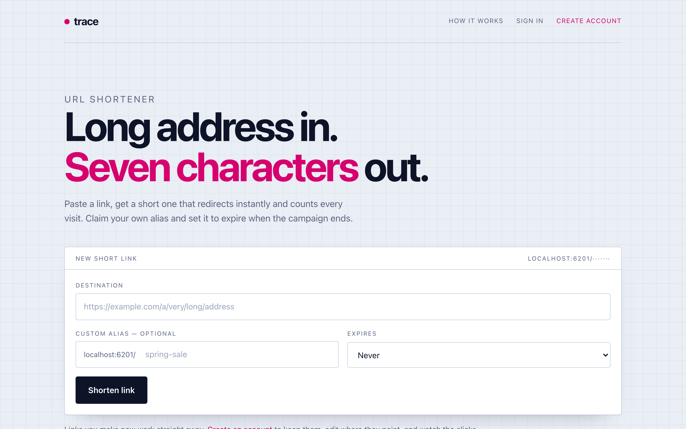

# Demo media

`trace-demo.mp4` (51 seconds, 1280x800, no audio) and the images in `../screenshots/`
were captured on 2026-10-27 from a production build (`npm run build`, then `next start`
on port 6201). The build ran against a separate, empty SQLite database, so no real data
appears in them.

## How the demo data was made

- One account, `demo@trace.example`, created through the sign-up form.
- Links created through the home page form. Click counts come from real `GET /<code>`
  requests to the redirect route, not from editing the database.
- One exception: `winter-promo` had its expiry date moved into the past directly in the
  demo database, so the expired state could be shown without waiting a day.
- The captions in the video are an overlay added during recording. They are not part of
  the app.

## Shot list and narration

Use this to re-record with a voice-over or after a UI change. Each line is one shot.

1. **Home page.** "Trace is a URL shortener with custom aliases, expiry dates and click
   counts."
2. **Fill the form** with a Next.js docs URL, alias `route-docs`, 30 days. "Paste a long
   link, claim an alias if you want one, and choose when it should stop working."
3. **Result card, then the QR code.** "The short link is ready, with a QR code drawn in
   the browser."
4. **Open `localhost:6201/route-docs`.** "Visiting the code is a 307 redirect to the
   destination."
5. **Stats page.** "That visit was counted. Stats show clicks, when the link was created
   and when it expires."
6. **Dashboard.** "Signed-in users see all of their links, live and expired."
7. **Edit `q3-report` and save.** "If a code is already printed and the file moves, point
   the same code at the new address."
8. **Open the expired code.** "Expired links stop redirecting and explain why."
9. **Private address, then a taken alias.** "Private addresses and aliases that are
   already taken are refused."
10. **Close.** "Built with Next.js 16, Prisma, Zod and Vitest. Setup is in the README."

## Re-recording

Run the app on port 6201 against a fresh database, create the account and links as
above, then record the shot list at a 1280x800 window. The original was driven by a
Playwright script (`recordVideo`) and converted to H.264 MP4 with ffmpeg. That script
lives outside the repository.
